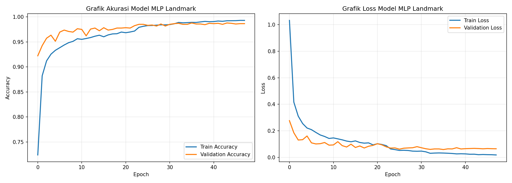
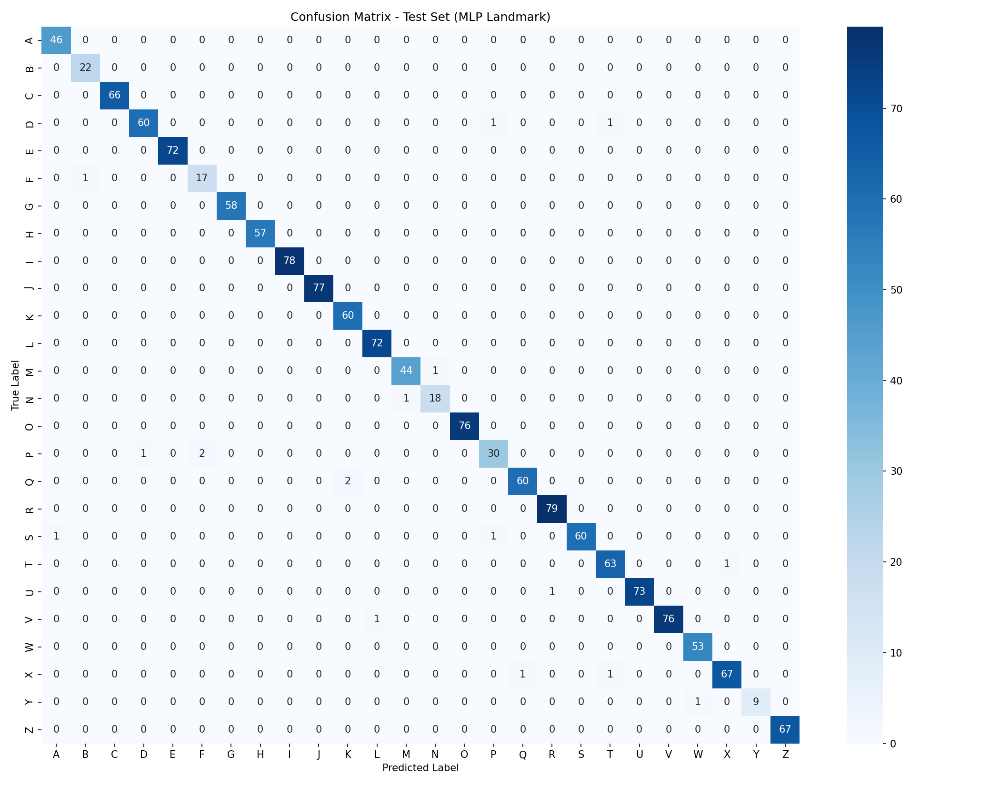

# Machine Learning Pipeline — Isyaratify (BISINDO)

Direktori ini memuat seluruh pipeline Machine Learning untuk proyek **Isyaratify**: audit dataset publik, ekstraksi dan normalisasi landmark tangan MediaPipe, pelatihan model *Multilayer Perceptron* (MLP), evaluasi performa klasifikasi 26 alfabet statis BISINDO (A–Z), serta ekspor model terkuantisasi TensorFlow Lite (`.tflite`) untuk inferensi *on-device* di Flutter.

---

## 1. Struktur Folder `ml/`

```text
ml/
├── README.md                      # Dokumentasi komprehensif modul ML
├── requirements.txt               # Daftar dependensi Python untuk pipeline ML
├── artifacts/                     # Model terlatih dan metadata produksi Flutter
│   ├── bisindo_mlp_landmark.keras        # Model utama TensorFlow/Keras
│   ├── bisindo_mlp_landmark_quant.tflite # Model terkuantisasi untuk Flutter (on-device)
│   ├── labels.txt                        # Daftar 26 kelas alfabet (A–Z)
│   └── labels_and_rules.json             # Metadata model, threshold, & aturan 1 vs 2 tangan
├── notebooks/                     # Notebook eksperimen & riset bertahap
│   ├── 01_dataset_audit_comparison.ipynb     # Audit kelayakan 3 kandidat dataset publik
│   ├── 02_feature_extraction_unimal_.ipynb    # Ekstraksi fitur & benchmarking baseline
│   └── 03_bisindo_mlp_landmark_final.ipynb    # Training final MLP, augmentasi, & Gradio demo
├── reports/                       # Laporan evaluasi, metrik, & visualisasi
│   ├── audit_dataset_comparison.csv          # Rangkuman perbandingan 3 dataset
│   ├── audit_kandidat_1_umn.csv              # Audit detail per kelas dataset UMN
│   ├── audit_kandidat_2_unimal.csv           # Audit detail per kelas dataset Unimal
│   ├── audit_kandidat_3_mendeley.csv         # Audit detail per kelas dataset Mendeley
│   ├── baseline_classification_report.csv    # Laporan presisi, recall, & F1 per huruf
│   ├── grafik_training_mlp.png               # Kurva akurasi & loss selama training
│   └── confusion_matrix_mlp.png              # Heatmap matriks konfusi 26 kelas A–Z
└── src/                           # Skrip Python modular produksi
    ├── feature_extraction.py                 # Ekstraksi & normalisasi MediaPipe landmark
    ├── train.py                              # Pelatihan MLP, augmentasi, & ekspor TFLite
    └── evaluate.py                           # Evaluasi akurasi, confusion matrix, & laporan
```

---

## 2. Ringkasan Audit 3 Kandidat Dataset

Pada tahap awal riset (`ml/notebooks/01_dataset_audit_comparison.ipynb`), dilakukan audit menggunakan **MediaPipe Hand Landmarker** (`num_hands=2`, `min_hand_detection_confidence=0.5`) terhadap 3 dataset publik untuk menguji keterbacaan titik sendi tangan:

| Kandidat Dataset | Sumber / Referensi | Jumlah Kelas | Total Gambar | Berhasil Diekstrak | Terdeteksi 1 Tangan | Terdeteksi 2 Tangan | Total Gagal | Tingkat Kegagalan (%) | Kelas Gagal >50% |
|---|---|---:|---:|---:|---:|---:|---:|---:|---:|
| **Kandidat 1** | Kaggle: `achmadnoer/alfabet-bisindo` (UMN) | 26 | 312 | 281 | 195 | 86 | 31 | 9.94% | 1 (`Z`: 66.67%) |
| **Kandidat 2** | Kaggle: `agungmrf/indonesian-sign-language-bisindo` (Unimal) | 26 | 11.470 | 9.070 | 5.446 | 3.624 | 2.400 | 20.92% | **0** |
| **Kandidat 3** | Mendeley Data: `4xnkvr88tk/1` | 26 | 8.040 | 5.763 | 3.219 | 2.544 | 2.277 | 28.32% | 1 (`V`: 51.33%) |

> **Keputusan Dataset:**
> **Kandidat 2 (Unimal ~11.500 gambar)** dipilih sebagai dataset acuan utama karena menyediakan volume sampel valid terbesar (9.070 gambar) dan merupakan satu-satunya dataset yang **tidak memiliki kelas dengan tingkat kegagalan >50%**.

---

## 3. Ekstraksi Fitur & Aturan Tangan (ADR 0002)

Agar inferensi model Python kompatibel penuh dengan aplikasi Flutter (`frontend/lib/services/classifier_service.dart`), diterapkan standarisasi representasi fitur berikut:

### 3.1 Normalisasi Spasial Landmark
1. MediaPipe mendeteksi **21 landmark** per tangan dengan koordinat $(x, y, z)$.
2. Setiap tangan ditranslasikan terhadap titik *wrist* (`landmark[0]`) sehingga wrist berada pada koordinat $(0, 0, 0)$.
3. Koordinat diskalakan dengan membaginya terhadap jarak Euclidean maksimum dari wrist ke titik terjauh pada tangan tersebut (dengan $\epsilon = 10^{-6}$ untuk stabilitas).
4. Satu tangan menghasilkan $21 \times 3 = 63$ nilai fitur. Dua tangan menghasilkan total **126 fitur**.

### 3.2 Aturan Kanonik 1 vs 2 Tangan (*Hand-Count Filter*)
Sistem mengelompokkan 26 alfabet BISINDO ke dalam dua kategori tegas:
* **Huruf 1 Tangan (10 huruf):** `C, E, I, J, L, O, R, U, V, Z`
  * Koordinat tangan kedua (indeks 63..125) dipaksa bernilai murni `0.0`.
* **Huruf 2 Tangan (16 huruf):** `A, B, D, F, G, H, K, M, N, P, Q, S, T, W, X, Y`
  * Koordinat tangan kedua wajib terdeteksi (tidak boleh bernilai nol seluruhnya).

---

## 4. Arsitektur Model MLP & Strategi Pelatihan

Model klasifikasi menggunakan arsitektur **Multilayer Perceptron (MLP)** dengan struktur lapisan sebagai berikut:

```text
Input Layer (126 Dimensi Fitur)
  │
  ├── Dense(256, activation='relu')
  ├── BatchNormalization()
  ├── Dropout(0.30)
  │
  ├── Dense(128, activation='relu')
  ├── BatchNormalization()
  ├── Dropout(0.25)
  │
  ├── Dense(64, activation='relu')
  ├── BatchNormalization()
  ├── Dropout(0.20)
  │
Output Layer (26 Kelas Softmax, A–Z)
```

### Strategi Pelatihan:
1. **Pembersihan Data:** Menghapus sampel oklusi pada huruf 2 tangan dan menolkan tangan kedua pada huruf 1 tangan.
2. **Safe Noise & Coordinate Scaling:**
   * Menambahkan Gaussian noise ($0.012$) secara selektif hanya pada koordinat aktif ($x \ne 0$) agar tidak mencemari slot kosong huruf 1 tangan.
   * Penskalaan ukuran tangan ($1.06\times$ dan $0.94\times$).
   * Oversampling & penajaman tambahan pada pasangan huruf yang rawan tertukar (`C, D, G, J, M, N, R, S, U, Y`).
3. **Class Weighting:** Menerapkan pembobotan kelas seimbang (*balanced class weights*) untuk menangani perbedaan jumlah sampel per kelas.
4. **Callbacks:** `EarlyStopping` (patience 12), `ReduceLROnPlateau` (factor 0.5, patience 5), dan `ModelCheckpoint` untuk menyimpan bobot terbaik.
5. **Kuantisasi TFLite:** Model Keras diekspor ke format TFLite kuantisasi dinamis (*Dynamic Range Quantization*), mereduksi ukuran file hingga di bawah 100 KB sehingga sangat ringan dijalankan di browser (WebAssembly) maupun Android.

---

## 5. Hasil Evaluasi & Grafik Performa

Berdasarkan pengujian pada *test set* independen (20% data stratified):
* **Akurasi Keseluruhan (Test Accuracy):** **95.76%**
* **Macro Average F1-Score:** **95.72%**
* **Weighted Average F1-Score:** **95.74%**

### 5.1 Grafik Riwayat Pelatihan (Accuracy & Loss)
Kurva berikut menunjukkan proses konvergensi model selama pelatihan tanpa terjadi *overfitting* yang signifikan:



### 5.2 Confusion Matrix (26 Kelas A–Z)
Distribusi prediksi model pada data uji menunjukkan tingkat akurasi tinggi pada seluruh alfabet BISINDO:



---

## 6. Panduan Menjalankan Skrip `ml/src/`

Pastikan dependensi telah terpasang:
```bash
pip install -r ml/requirements.txt
```

### 6.1 Ekstraksi Fitur Landmark (`feature_extraction.py`)
Mengekstrak 126 fitur MediaPipe dari direktori gambar dataset dan menyimpannya ke format `.npz`:
```bash
python ml/src/feature_extraction.py \
  --dataset-dirs /path/to/dataset_unimal \
  --output-npz ml/artifacts/bisindo_unimal_features.npz \
  --output-csv ml/artifacts/bisindo_unimal_features.csv
```

### 6.2 Melatih Model & Ekspor TFLite (`train.py`)
Menjalankan pembersihan aturan 1 vs 2 tangan, augmentasi, pelatihan MLP, serta ekspor otomatis ke `.keras`, `.tflite`, dan `labels_and_rules.json`:
```bash
python ml/src/train.py \
  --features-path ml/artifacts/bisindo_unimal_features.npz \
  --output-dir ml/artifacts \
  --epochs 80 \
  --batch-size 32 \
  --lr 0.001
```

### 6.3 Evaluasi Model & Pembuatan Laporan (`evaluate.py`)
Mengevaluasi model Keras atau TFLite pada data uji, menghasilkan gambar confusion matrix, serta mengekspor classification report ke CSV:
```bash
# Evaluasi model Keras
python ml/src/evaluate.py \
  --model-path ml/artifacts/bisindo_mlp_landmark.keras \
  --test-data-path ml/artifacts/test_split.npz \
  --output-dir ml/reports

# Atau evaluasi langsung model TFLite terkuantisasi
python ml/src/evaluate.py \
  --model-path ml/artifacts/bisindo_mlp_landmark_quant.tflite \
  --test-data-path ml/artifacts/test_split.npz \
  --output-dir ml/reports
```

---

## 7. Integrasi dengan Frontend Flutter

Hasil ekspor dari pipeline ini langsung disinkronkan ke aplikasi Flutter:
1. `ml/artifacts/bisindo_mlp_landmark_quant.tflite` disalin ke `frontend/assets/ml/`.
2. `ml/artifacts/labels_and_rules.json` menjadi acuan ambang batas keyakinan (`confidence_threshold: 0.55`) dan ukuran *smoothing window* (`7 frame`) pada `frontend/lib/services/classifier_service.dart` dan `TemporalSmoother`.
